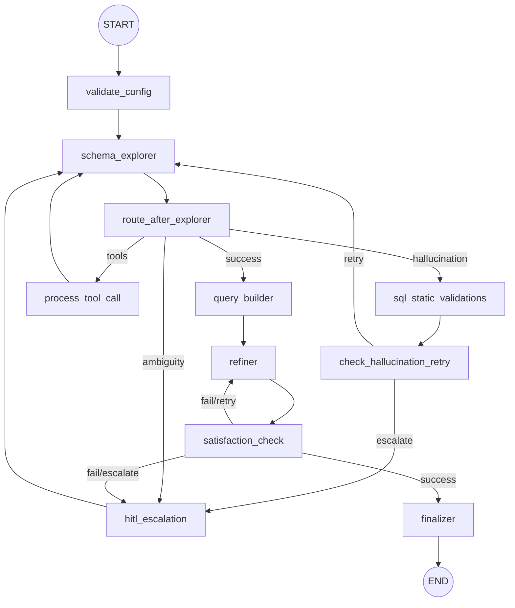

# Text2SQL Agent Service

This service runs the LangGraph-based multi-agent pipeline for translating natural language to SQL.

## Architecture

Below is the execution graph of the agent:




## Running the deep agent locally

Code layout (`src/deep_agent/`):

```
agent.py          create_deep_agent(): wires model, tools, prompt, skills, middleware, subagents
service.py        run_deep_chat(): serving behind chat_with_agent (threads, timeout_s, streaming, response)
cli.py            developer CLI
context.py        per-request context, state fields, user-message helpers, date prefix
observability.py  Langfuse run config and scores
resources.py      skills wiring (read-only /skills/)
tools/            what the model can call: sql, metadata, location (+ envelope, trino_errors)
answer/           the final answer: schema, verification (did the SQL run), middleware, render
validator/        independent semantic review before submit: reviewer (the agent), modes (wiring)
middleware/       cross-cutting: catalog in every model call, built-in tool filter
prompts/          system.md, validator.md + registry.py (Langfuse / packaged)
skills/           temporal-analyst, spatial-analyst
```

The deep agent (`src/deep_agent/`) has a CLI entry point:

```bash
uv sync
uv run deep-agent "כמה טיסות המריאו מצרפת"           # single question, fresh thread
uv run deep-agent --interactive --session-memory      # REPL, shared thread across questions
uv run deep-agent "..." --connection-id 89            # override JEEN_METADATA_CONNECTION_ID
uv run deep-agent "..." --log-file runs/runs.jsonl    # append one JSON line per run
```

It reads the same `agent/.env` settings as the API (LLM, Trino, Jeen metadata MCP, Langfuse).
Run logs are opt-in and git-ignored (`agent/runs/`, `agent/*.jsonl`, `agent/*.csv`); Langfuse is the system of record for traces.

### Semantic validation (deep agent)

A SQL answer needs two approvals **before** it is submitted:

1. **It ran:** the SQL executed successfully with `execute_trino_query` in this turn (a limited sample counts; the
   full rows are fetched once more for the user).
2. **It answers the question:** the `semantic-validator` subagent (`src/deep_agent/validator/`) passed it. The agent
   calls it through `task` with the SQL and its assumptions; the reviewer's input is built by our code from facts — the
   user's own messages, the SQL, its recorded rows, the assumptions as claims to check, the catalog and the date —
   never from the agent's reasoning. It judges by reading (no SQL tools) and returns pass, fail with issues and
   evidence, or — rarely, when only data can settle a doubt it can see — needs_check with specific checks; the agent
   runs them and asks for review again, and the reviewer then sees their real results (prompt: `prompts/validator.md`,
   `text2sql/deep_agent/validator` in Langfuse).

`submit_answer` only checks those records. Without them it is refused with the reason and the agent continues; a SQL
changed after its review needs a new one. After a fail the agent fixes the SQL, or disputes: it submits the same SQL
with `validation_response` (recorded as disputed and shown to the user).

| Setting | Default | |
|---|---|---|
| `DEEP_AGENT_SEMANTIC_VALIDATION` | `always` | `on_demand` = the reviewer is offered and the agent decides whether to call it; `off` = no reviewer. In both, only approval 1 is required |
| `DEEP_AGENT_VALIDATOR_MAX_ROUNDS` | none | optional: after this many reviews in a turn, an unreviewed SQL is accepted as `not_validated` |
| `DEEP_AGENT_STRICT_SUBMIT` | `false` | `true` = no recovery of answers written as text and no reminder: a model that doesn't call `submit_answer` ends without an answer |

The response's `semantic_validation` reports the review of the **final** SQL: `verdict` (`passed` / `disputed` /
`not_validated`), `rounds`, `issues`, `reviewed_final_sql`. Langfuse gets `validation_rounds` and, when the final SQL
was reviewed, `semantic_validation_passed`.

### SQL safety (deep agent)

Every SQL the deep agent runs goes through `agent/utils/sql_guard.py` (sqlglot, Trino dialect):
- exactly one read-only statement (`SELECT` / `WITH` / set operations, plus `SHOW` / `DESCRIBE`); writes, DDL, `CALL`, `SET`, multi-statements, SQL comments and `TABLE(...)` pass-through functions are rejected with `FORBIDDEN_STATEMENT`
- an outer `LIMIT` of cap + 1 is enforced at the AST level (`DEEP_AGENT_MAX_ROWS`, default 100; `DEEP_AGENT_MAX_SAMPLE_ROWS`, default 10) and results report `truncated`. A `LIMIT` / `FETCH FIRST` already within the cap is left as written, and set operations get the `LIMIT` in place so their `ORDER BY` survives
- set either variable to `none` to disable that ceiling: SQL then runs exactly as written and every row is returned (mind the model's context size)
- table and column names in `get_sample_rows` / `get_column_distinct_values` are parsed and quoted by sqlglot, never string-interpolated

The guard is an application-level control. The Trino principal used by the agent should also be SELECT-only.

### Tracing (deep agent)

Every deep-agent run is **one Langfuse trace** built by `deep_agent.observability.build_run_config()`:
- session = thread id, user = `user_id`, tag `deep-agent`, metadata `agent_version` (`DEEP_AGENT_VERSION` env, e.g. the git SHA, else the package version) and `connection_id`
- all model calls, tool calls, and subagent calls are nested observations
- `execute_trino_query` / `get_sample_rows` / `get_column_distinct_values` observations carry `trino_query_id`, `execution_time_ms`, `row_count`, `truncated` (or Trino's `error_name` / `error_type`) as metadata
- run-level scores: `deep-agent.model_calls`, `.tool_calls`, `.sql_executions`, `.latency_s`

In Langfuse, filter traces by **tag = `deep-agent`** (save it as a view). Disable tracing with `DEEP_AGENT_TRACING_ENABLED=false`.

**Prompts** are served from Langfuse — `text2sql/deep_agent/system` and `text2sql/deep_agent/validator`, by label
`DEEP_AGENT_PROMPT_LABEL` (default `production`) — and each trace links to the prompt version it used. A label move
takes effect from the next request, no redeploy. The packaged `prompts/*.md` are the fallback when Langfuse is
unreachable or has no such prompt; `DEEP_AGENT_LANGFUSE_PROMPTS=false` always uses them. After editing the `.md` files,
push them as a new version: `uv run python scripts/sync_deep_agent_prompts.py --label staging`.

### Serving the deep agent

The agent service exposes one MCP tool per agent, each with only its own arguments, and the backend one endpoint per tool:

| Backend endpoint | MCP tool |
|---|---|
| `POST /api/agent/chat` | `chat_with_agent` (the legacy graph) |
| `POST /api/agent/deep/chat` | `deep_agent` |

| Setting / argument | Effect |
|---|---|
| `thread_id` | continue a thread on the same agent; resuming a thread the deep agent never saw returns an error |
| `DEEP_AGENT_CHECKPOINT_DB_URL=postgresql://…` | durable deep-agent threads (shared by replicas, survive restarts); unset = in-memory |
| `timeout_s` argument | how long the caller waits; the run is cancelled then (a query already running finishes first). Omitted = no limit. The backend sends 290 (it waits 300). |

The deep agent is built once per process and streams the same Redis `agent_stream:{thread_id}` events as the legacy graph
(nodes `deep:<tool>` and `deep:answer`). Responses keep the legacy contract and add `verification`
(matched / re_executed / rejected / re_execution_failed / no_answer), `executed` (the final SQL ran and the rows are
Trino's), `recovered_from_text`, `semantic_validation` and `confidence`. Each turn's answer is checked only against SQL executed in that turn.

Clarifications are off (`DEEP_AGENT_CLARIFICATIONS_ENABLED=false`). When on, a clarification comes back as
`status: "interrupted"` with `interrupt_details.type = "hitl_escalation"` (`subtype: "clarification"`); the user's answer
is sent as `resume_value` (string or `{"feedback": ...}`).
