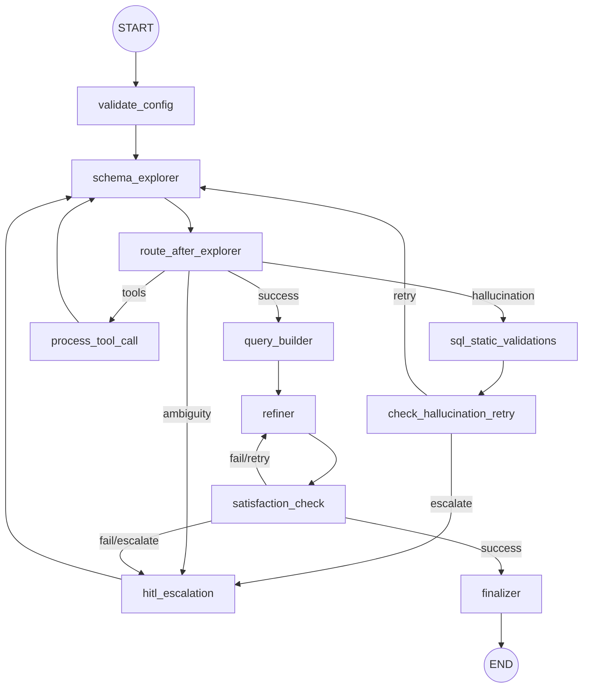

# Text2SQL Agent Service

This service runs the LangGraph-based multi-agent pipeline for translating natural language to SQL.

## Architecture

Below is the execution graph of the agent:




## Running the deep agent locally

The deep agent (`src/deep_agent/`) has a CLI entry point:

```bash
uv sync
uv run deep-agent "כמה טיסות המריאו מצרפת"           # single question, fresh thread
uv run deep-agent --interactive --session-memory      # REPL, shared thread across questions
uv run deep-agent "..." --connection-id 89            # override JEEN_METADATA_CONNECTION_ID
uv run deep-agent "..." --log-file runs/runs.jsonl    # append one JSON line per run
```

It reads the same `agent/.env` settings as the API (LLM, Trino, Jeen metadata MCP, Langfuse).
Run logs are opt-in and git-ignored (`agent/runs/`, `agent/*.jsonl`, `agent/*.csv`); Langfuse is the system of record for traces.

### SQL safety (deep agent)

Every SQL the deep agent runs goes through `agent/utils/sql_guard.py` (sqlglot, Trino dialect):
- exactly one read-only statement (`SELECT` / `WITH` / set operations, plus `SHOW` / `DESCRIBE`); writes, DDL, `CALL`, `SET`, multi-statements, SQL comments and `TABLE(...)` pass-through functions are rejected with `FORBIDDEN_STATEMENT`
- an outer `LIMIT` of cap + 1 is enforced at the AST level (`DEEP_AGENT_MAX_ROWS`, default 100; `DEEP_AGENT_MAX_SAMPLE_ROWS`, default 10) and results report `truncated`
- table and column names in `get_sample_rows` / `get_column_distinct_values` are parsed and quoted by sqlglot, never string-interpolated

The guard is an application-level control. The Trino principal used by the agent should also be SELECT-only.

### Tracing (deep agent)

Every deep-agent run is **one Langfuse trace** built by `deep_agent.observability.build_run_config()`:
- session = thread id, user = `user_id`, tag `deep-agent`, metadata `agent_version` (`DEEP_AGENT_VERSION` env, e.g. the git SHA, else the package version) and `connection_id`
- all model calls, tool calls, subagent calls and enrichment LLM calls are nested observations
- `execute_trino_query` / `get_sample_rows` / `get_column_distinct_values` observations carry `trino_query_id`, `execution_time_ms`, `row_count`, `truncated` (or `error_category`) as metadata
- run-level scores: `deep-agent.model_calls`, `.tool_calls`, `.sql_executions`, `.executed_successfully`, `.final_sql_present`, `.latency_s`

In Langfuse, filter traces by **tag = `deep-agent`** (save it as a view). Disable tracing with `DEEP_AGENT_TRACING_ENABLED=false`.

### Utils-Server tools (deep agent, optional)

A curated subset of [Utils-Server](https://github.com/matzpen-agency/Utils-Server) tools is loaded from the Jarvis Registry
MCP gateway at startup (`deep_agent/utils_mcp.py`). Set:

```bash
JARVIS_GATEWAY_URL=http://jarvis-mcp-gateway:8001   # unset = disabled
JARVIS_MCP_NAMESPACE=global                         # gateway namespace exposing Utils-Server
JARVIS_API_KEY=...                                  # sent as "Authorization: ApiKey <key>"
```

| Agent | Tools |
|---|---|
| main | `datetime_parse_relative_expression`, `text_normalize`, `trino_validate_spatial_expression` |
| value-resolver | `datetime_parse_relative_expression`, `text_normalize`, `geo_create_buffer`, `geo_validate_geometry` |

The registry service identity needs the `datetime:read`, `text:read`, `geo:read` and `trino:read` scopes, and each tool must be
approved in the registry. SQL is never executed through Utils-Server. If the gateway is unreachable the agent starts without
these tools and logs a warning.
