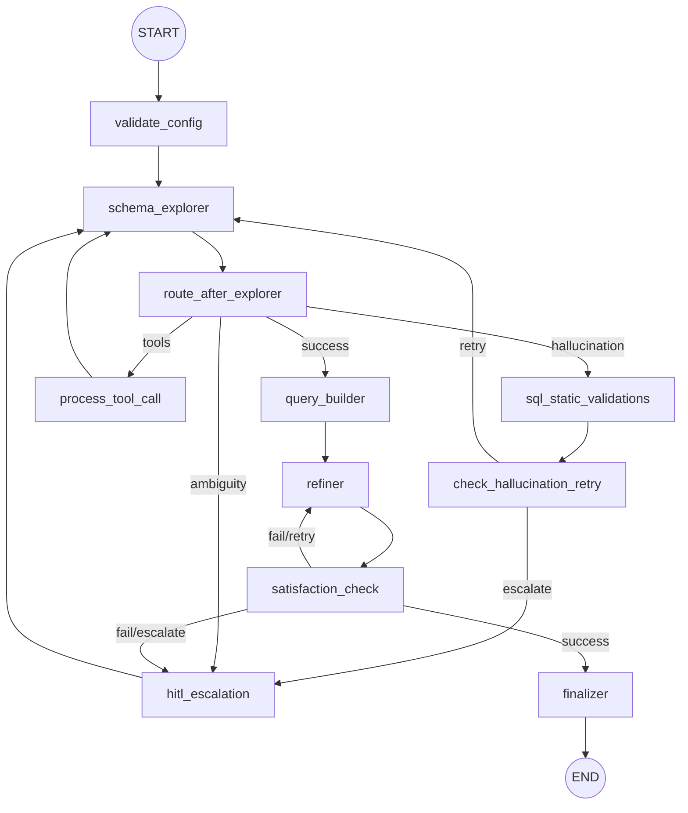

# Text2SQL Agent Service

This service runs the LangGraph-based multi-agent pipeline for translating natural language to SQL.

## Architecture

Below is the execution graph of the agent:




## Running the deep agent locally

The deep agent (`src/deep_agent/`) has a CLI entry point:

```bash
uv sync
uv run deep-agent "כמה טיסות המריאו מצרפת"           # single question, fresh thread
uv run deep-agent --interactive --session-memory      # REPL, shared thread across questions
uv run deep-agent "..." --connection-id 89            # override JEEN_METADATA_CONNECTION_ID
uv run deep-agent "..." --log-file runs/runs.jsonl    # append one JSON line per run
```

It reads the same `agent/.env` settings as the API (LLM, Trino, Jeen metadata MCP, Langfuse).
Run logs are opt-in and git-ignored (`agent/runs/`, `agent/*.jsonl`, `agent/*.csv`); Langfuse is the system of record for traces.

### Semantic validation (deep agent)

An independent reviewer (`src/deep_agent/validator.py`) checks whether a SQL answer really answers the user's request:
a separate agent with a fresh context (the user's messages, the SQL, its rows, the stated assumptions and the catalog —
not the main agent's reasoning), read-only diagnostic tools, and a verdict of pass, or fail with issues and evidence.
Its prompt is `prompts/validator.md` (`deep-agent/validator` in Langfuse). `DEEP_AGENT_SEMANTIC_VALIDATION` picks how it is used:

| Mode | |
|---|---|
| `on_demand` | a `semantic-validator` subagent the agent calls through `task` when it judges a review worthwhile; the verdict comes back to the agent, which decides what to do |
| `always` (default) | every submitted answer is reviewed before the run ends; on fail the agent fixes the SQL (reviewed again) or resubmits it with a justification (`validation_response`, recorded as disputed). `DEEP_AGENT_VALIDATOR_MAX_ROUNDS` optionally limits reviews per turn (default none) |
| `off` | no reviewer |

The outcome for the final answer is the response's `semantic_validation`: `verdict` (`passed` / `failed` / `disputed` /
`not_validated`), `rounds`, `issues`, `reviewed_final_sql` (a review of an earlier SQL doesn't count for the final one).
Langfuse gets `validation_rounds` and, when the final SQL was reviewed, `semantic_validation_passed` — compare the modes
on accuracy and cost, then keep one.

### SQL safety (deep agent)

Every SQL the deep agent runs goes through `agent/utils/sql_guard.py` (sqlglot, Trino dialect):
- exactly one read-only statement (`SELECT` / `WITH` / set operations, plus `SHOW` / `DESCRIBE`); writes, DDL, `CALL`, `SET`, multi-statements, SQL comments and `TABLE(...)` pass-through functions are rejected with `FORBIDDEN_STATEMENT`
- an outer `LIMIT` of cap + 1 is enforced at the AST level (`DEEP_AGENT_MAX_ROWS`, default 100; `DEEP_AGENT_MAX_SAMPLE_ROWS`, default 10) and results report `truncated`. A `LIMIT` / `FETCH FIRST` already within the cap is left as written, and set operations get the `LIMIT` in place so their `ORDER BY` survives
- set either variable to `none` to disable that ceiling: SQL then runs exactly as written and every row is returned (mind the model's context size)
- table and column names in `get_sample_rows` / `get_column_distinct_values` are parsed and quoted by sqlglot, never string-interpolated

The guard is an application-level control. The Trino principal used by the agent should also be SELECT-only.

### Tracing (deep agent)

Every deep-agent run is **one Langfuse trace** built by `deep_agent.observability.build_run_config()`:
- session = thread id, user = `user_id`, tag `deep-agent`, metadata `agent_version` (`DEEP_AGENT_VERSION` env, e.g. the git SHA, else the package version) and `connection_id`
- all model calls, tool calls, subagent calls and enrichment LLM calls are nested observations
- `execute_trino_query` / `get_sample_rows` / `get_column_distinct_values` observations carry `trino_query_id`, `execution_time_ms`, `row_count`, `truncated` (or Trino's `error_name` / `error_type`) as metadata
- run-level scores: `deep-agent.model_calls`, `.tool_calls`, `.sql_executions`, `.latency_s`

In Langfuse, filter traces by **tag = `deep-agent`** (save it as a view). Disable tracing with `DEEP_AGENT_TRACING_ENABLED=false`.

### Serving the deep agent

The UI → backend → agent path is the `chat_with_agent` MCP tool. It runs the legacy graph or the deep agent:

| Setting / argument | Effect |
|---|---|
| `AGENT_ENGINE=legacy` (default) / `deep` | default engine for new threads |
| `engine` argument (backend `POST /api/agent/chat` body: `"engine": "deep"`) | per-request choice |
| thread id `deep-…` | resumes always go back to the deep agent (and legacy threads to the legacy graph) |
| `DEEP_AGENT_CHECKPOINT_DB_URL=postgresql://…` | durable deep-agent threads (shared by replicas, survive restarts); unset = in-memory |
| `timeout_s` argument | how long the caller waits; the run is cancelled then (a query already running finishes first). Omitted = no limit. The backend sends 290 (it waits 300). |

The deep agent is built once per process and streams the same Redis `agent_stream:{thread_id}` events as the legacy graph
(nodes `deep:<tool>` and `deep:answer`). Responses keep the legacy contract and add `engine`, `verification`
(matched / re_executed / rejected / re_execution_failed / no_answer), `executed` (the final SQL ran and the rows are
Trino's), `recovered_from_text`, `semantic_validation` and `confidence`. Each turn's answer is checked only against SQL executed in that turn.

Clarifications are off (`DEEP_AGENT_CLARIFICATIONS_ENABLED=false`). When on, a clarification comes back as
`status: "interrupted"` with `interrupt_details.type = "hitl_escalation"` (`subtype: "clarification"`); the user's answer
is sent as `resume_value` (string or `{"feedback": ...}`).
