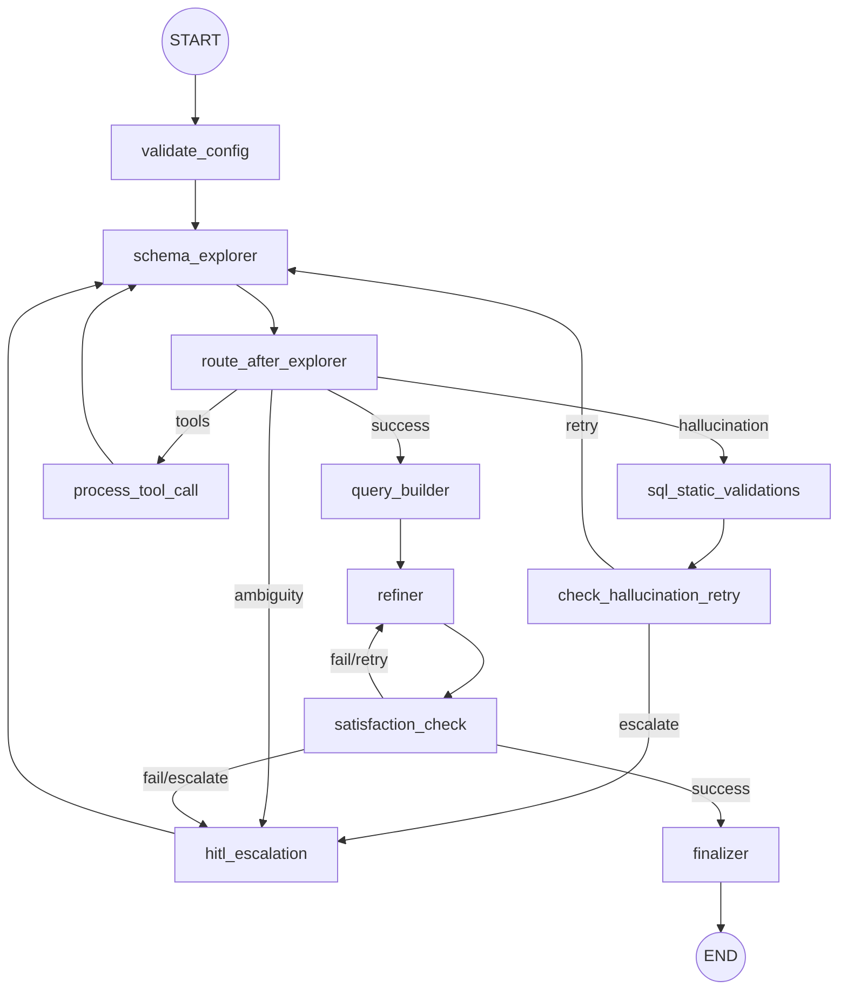

# Text2SQL Agent Service

This service runs the LangGraph-based multi-agent pipeline for translating natural language to SQL.

## Architecture

Below is the execution graph of the agent:




## Running the deep agent locally

The deep agent (`src/deep_agent/`) has a CLI entry point:

```bash
uv sync
uv run deep-agent "כמה טיסות המריאו מצרפת"           # single question, fresh thread
uv run deep-agent --interactive --session-memory      # REPL, shared thread across questions
uv run deep-agent "..." --connection-id 89            # override JEEN_METADATA_CONNECTION_ID
uv run deep-agent "..." --log-file runs/runs.jsonl    # append one JSON line per run
```

It reads the same `agent/.env` settings as the API (LLM, Trino, Jeen metadata MCP, Langfuse).
Run logs are opt-in and git-ignored (`agent/runs/`, `agent/*.jsonl`, `agent/*.csv`); Langfuse is the system of record for traces.
